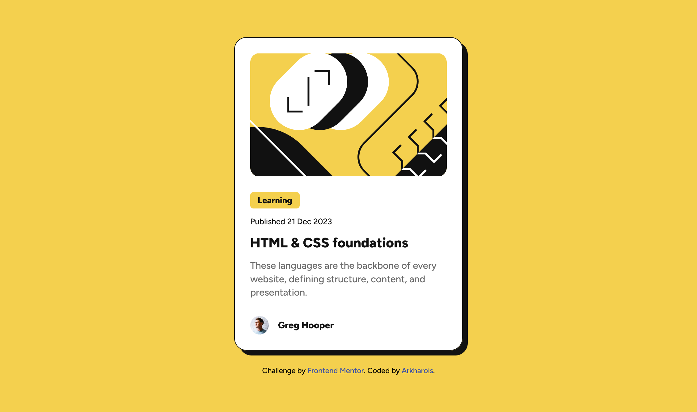
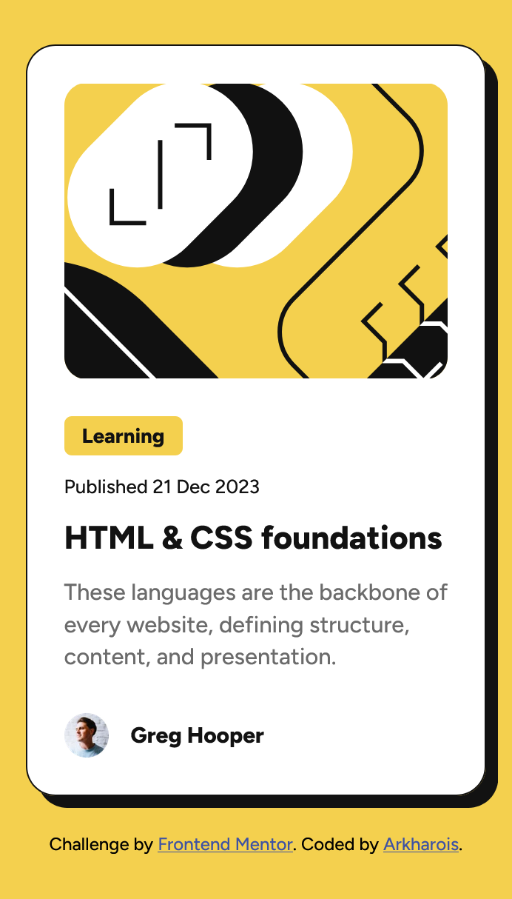
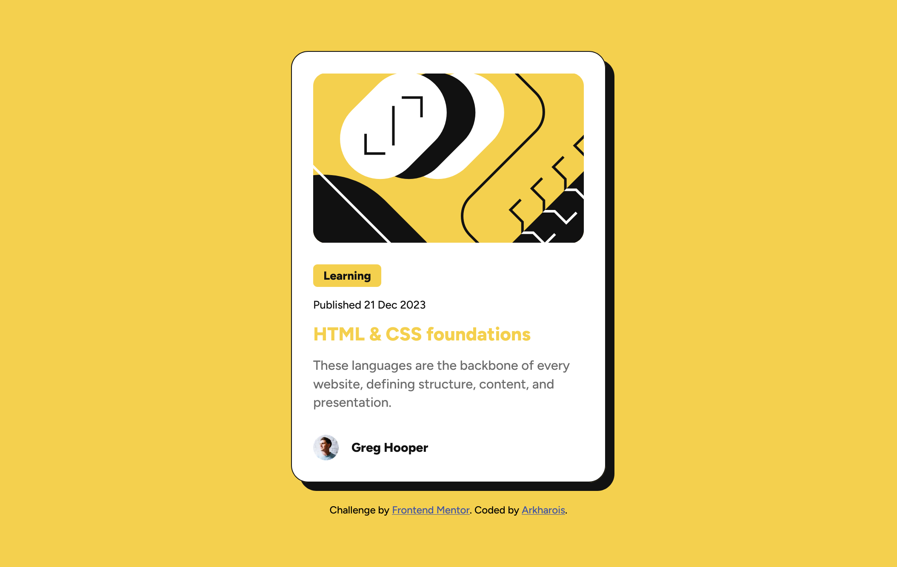

# Frontend Mentor - Blog preview card solution

This is a solution to the [Blog preview card challenge on Frontend Mentor](https://www.frontendmentor.io/challenges/blog-preview-card-ckPaj01IcS). Frontend Mentor challenges help you improve your coding skills by building realistic projects. 

## Table of contents

- [Overview](#overview)
  - [The challenge](#the-challenge)
  - [Screenshot](#screenshot)
  - [Links](#links)
- [My process](#my-process)
  - [Built with](#built-with)
  - [What I learned](#what-i-learned)
  - [Continued development](#continued-development)
  - [AI Collaboration](#ai-collaboration)
- [Author](#author)


## Overview

### The challenge

The goal of this challenge was to build a Blog preview card that slightly changes it's box-shadow and header color with html and css.

### Screenshot

**Default Deskstop**


**346px x 607px**


**Hover---**


### Links

- Solution URL: [Blog preview card](https://arkharios.github.io/Blog-Preview-Card)

## My process

### Built with

- Semantic HTML5 markup
- CSS custom properties
- Flexbox


### What I learned

I learnt how to hide an images overflow so the border-radius of the container it's called is inherited by the image.

```html
<div class="card-image">
    
</div>
```
```css
.card .card-image {
    width: 100%;
    height: 20rem;
    overflow: hidden;
    border-radius: 1.5rem;
}

.card .card-image img {
    width: 100%;
    height: 100%;
    object-fit: cover;
}
```


### Continued development

Doing this challenge, I realized that I found it hard to recall some key CSS concepts like transform, transition, box-shadow and rem/em and had to stop and research the subject again when I came across them. I also realized that I toke my viscode AI suggestions before I actually atempted writing out the code my self, so I would be aiming to code the next challenge entirely on my own, ignoring suggestions to cement my foundations.


### AI Collaboration

I used Chatgpt after coding to debug my css where the author's name at the bottom of the card inherited the margin-border of the paragraph element.

## Author

- Frontend Mentor - [@Arkharios](https://www.frontendmentor.io/profile/Arkharios)
- GitHub - [@Arkharios](https://github.com/Arkharios)

